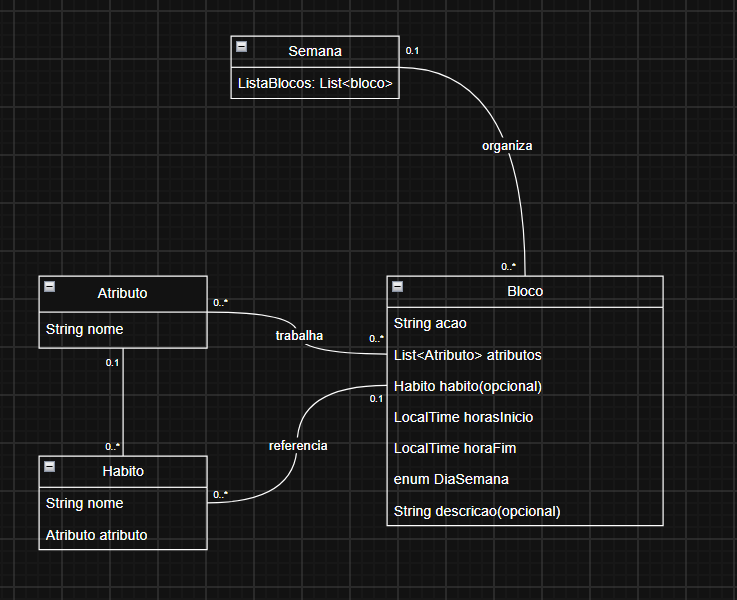

# Diagrama de classes

Relação entre Semana, Bloco, Atributo e Hábito. O desenho abaixo é o arquivo do draw.io e está desatualizado. A atualização do diagrama fica manual.

## O que o desenho não acompanha

Em relação às classes Java atuais:

- Em `Bloco`, o fim do intervalo se chama `horasFinal`. No desenho está `horaFim`.
- Em `Bloco`, o dia é `String diaDaSemana`. No desenho está `enum DiaSemana`, e esse enum não existe no código.
- Em `Bloco`, a lista se chama `atributo`. No desenho está `atributos`.
- Em `Semana`, o campo é `listaBlocos`, do tipo `ArrayList<Bloco>`. No desenho está `ListaBlocos: List<bloco>`.
- `Habito` tem o campo `atributo`, como no desenho, mas o menu só pede o nome e grava o hábito sem atributo.
- `Bloco` não guarda a semana. A lista de blocos vive só em `Semana`.

Em relação aos [requisitos](../requisitos.md), o desenho cobre só o núcleo do console. Ficam de fora usuário e sessão, hobby, caderno (divisória e nota), perfil (foto, metas, início da semana, aparência, fuso e lembretes) e o estado ativo ou inativo de hábito e hobby. `Semana` também não identifica qual semana é.
