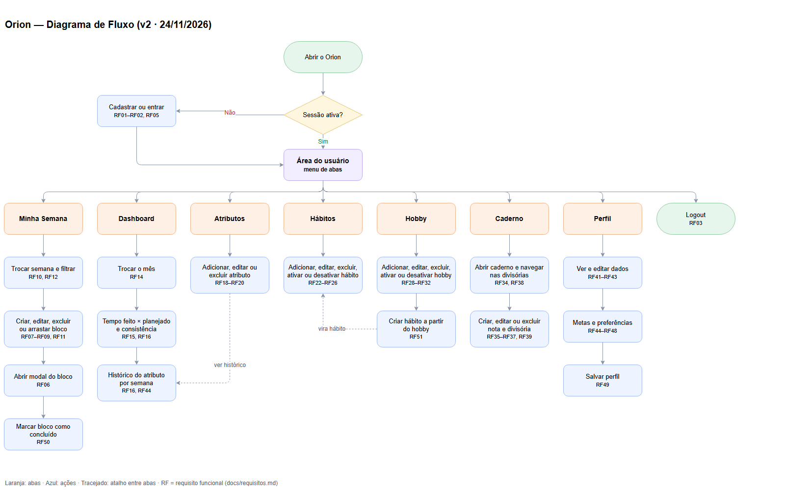

# Diagrama de fluxo

Caminho do usuário pelas abas do Orion, descrito nos [requisitos](../requisitos.md) e nas telas da [documentação inicial](../documentacao-inicial.md). Cada pessoa autenticada só percorre os próprios dados.

- **Fonte editável:** [diagrama-de-fluxo.drawio](diagrama-de-fluxo.drawio), no draw.io.
- **Imagem:** exportada do `.drawio`. Quando o desenho mudar, exportar de novo e substituir.

A aba de IA não entra neste fluxo, porque está fora da v1.0.0.

| Trecho | Requisitos |
| --- | --- |
| Entrada e sessão | RF01–RF05 |
| Minha Semana: trocar semana e filtrar | RF10, RF12 |
| Minha Semana: criar, editar, excluir e arrastar bloco | RF07–RF09, RF11 |
| Modal de detalhes do bloco | RF06 |
| Marcar bloco como concluído | RF50 |
| Dashboard | RF13–RF16 |
| Histórico do atributo | RF16, RF44 |
| Atributos | RF17–RF20 |
| Hábitos | RF21–RF26 |
| Hobby | RF27–RF32 |
| Criar hábito a partir do hobby | RF51 |
| Caderno | RF33–RF39 |
| Perfil | RF40–RF49 |
