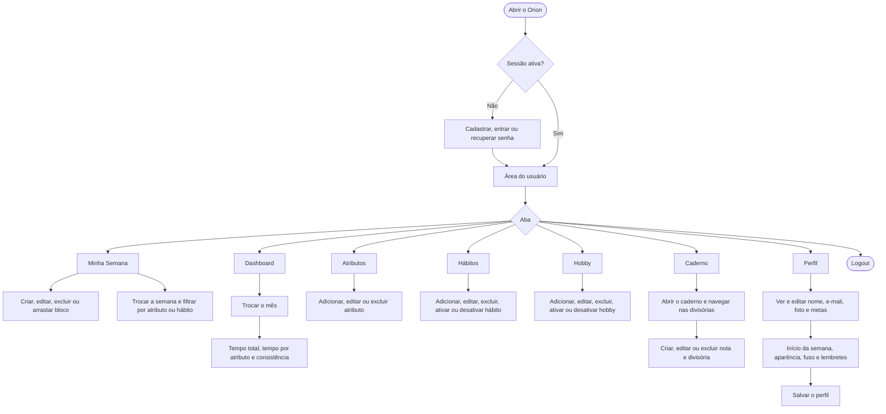

# Diagrama de fluxo

Fluxo do produto descrito em [requisitos.md](../requisitos.md). Cada pessoa autenticada só percorre o próprio conjunto de dados.

O menu de console que existe hoje cobre só um trecho deste fluxo: criar e excluir atributo, criar e excluir hábito, criar, editar, excluir e ver bloco, e ver o tempo de um atributo. Não há login, dashboard, hobby, caderno nem perfil.

| Trecho | Requisitos |
| --- | --- |
| Entrada e sessão | RF01–RF05 |
| Minha Semana | RF06–RF12 |
| Dashboard | RF13–RF16 |
| Atributos | RF17–RF20 |
| Hábitos | RF21–RF26 |
| Hobby | RF27–RF32 |
| Caderno | RF33–RF39 |
| Perfil | RF40–RF49 |
