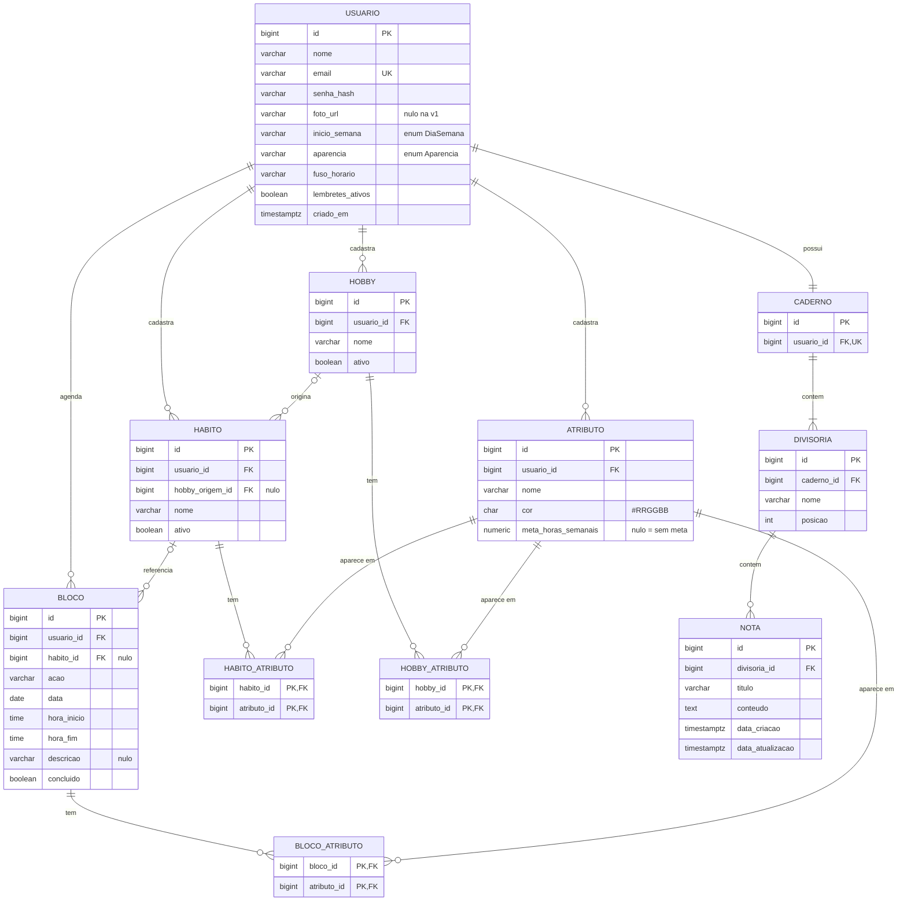

# Modelo de dados

Tradução do [diagrama de classes](diagrama-de-classes.md) v2 para tabelas do PostgreSQL. É a base das migrations do Flyway (`backend/src/main/resources/db/migration`). Quando este modelo mudar, uma migration nova é criada. Migrations já aplicadas nunca são editadas.

Status: **proposta derivada do diagrama v2, validar na S04**.

## Restrições e índices

| Tabela | Restrição | Regra |
| --- | --- | --- |
| usuario | `UNIQUE (lower(email))` | RN04 |
| atributo | `UNIQUE (usuario_id, lower(nome))` | RN09 |
| habito, hobby | `UNIQUE (usuario_id, lower(nome))` | RN13 |
| bloco | `CHECK (hora_fim > hora_inicio)` e índice em `(usuario_id, data)` | RN20, RN18 |
| bloco | `concluido` com padrão `false` | RN37 |
| divisoria | `UNIQUE (caderno_id, lower(nome))` | RN30 |
| caderno | `UNIQUE (usuario_id)` | RN29 |

A sobreposição de blocos (RN21) e o "só concluir bloco que já começou" (RN37) são verificados na camada de serviço.

## Exclusões em cascata

| Ao excluir | Efeito | Regra |
| --- | --- | --- |
| Usuário | Apaga todos os dados dele | RN01 |
| Atributo | Apaga só as linhas em `habito_atributo`, `hobby_atributo` e `bloco_atributo` | RN12 |
| Hobby | Apaga as linhas em `hobby_atributo`. `habito.hobby_origem_id` vira nulo | RN17 |
| Hábito | Apaga as linhas em `habito_atributo`. `bloco.habito_id` vira nulo | RN16 |
| Bloco | Apaga as linhas em `bloco_atributo` | — |
| Divisória | Apaga as notas dela | RN31 |

## Diferenças em relação ao diagrama de classes

São detalhes de persistência. O diagrama não precisa mudar por causa deles.

- Todas as tabelas têm `id`, e as relações viram chaves estrangeiras.
- As relações muitos-para-muitos com Atributo viram as tabelas `habito_atributo`, `hobby_atributo` e `bloco_atributo`.
- As preferências de perfil ficam na própria tabela `usuario`, porque a relação é 1 para 1.
